<div align="center">

# Brief.

**All the news that matters. None of the noise.**

A news aggregator that reads 68 RSS feeds across eleven categories, extracts every article, writes a three-sentence extractive summary and ranks the day's top stories by how many outlets cover them. No LLM or paid API involved.


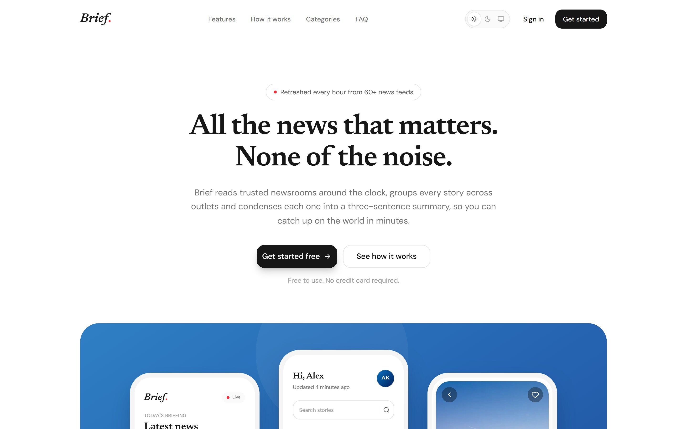

</div>

## Screenshots

> All screenshots are captured from the running app with live data from a real sync.

### Home feed

Top stories ranked by cross-outlet coverage, followed by the latest news filtered by category.

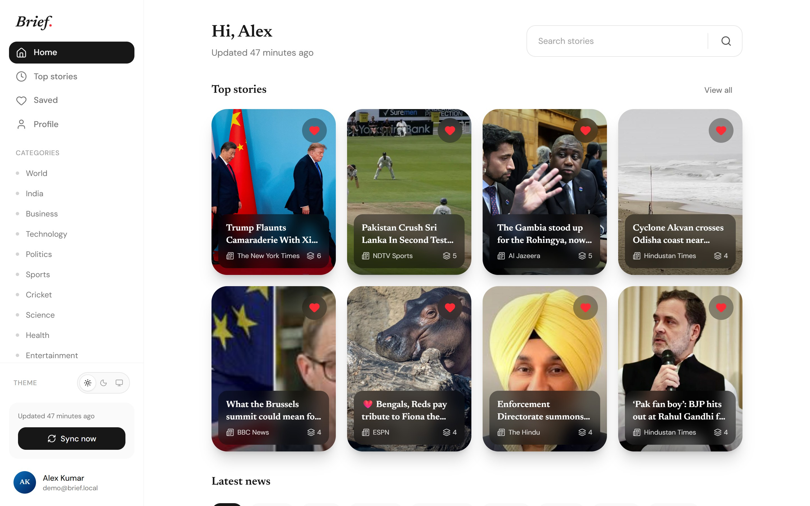

### Story summary

Each article gets a TextRank summary, reading time and a link back to the original reporting.

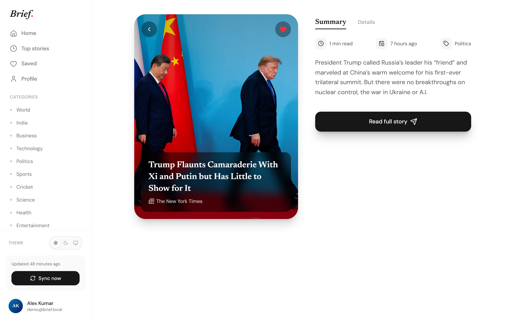

<table>
  <tr>
    <td width="50%">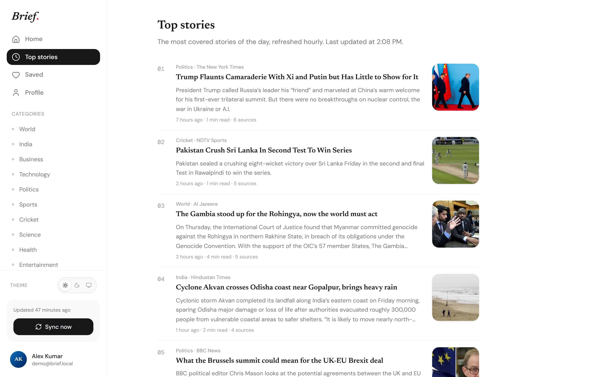</td>
    <td width="50%">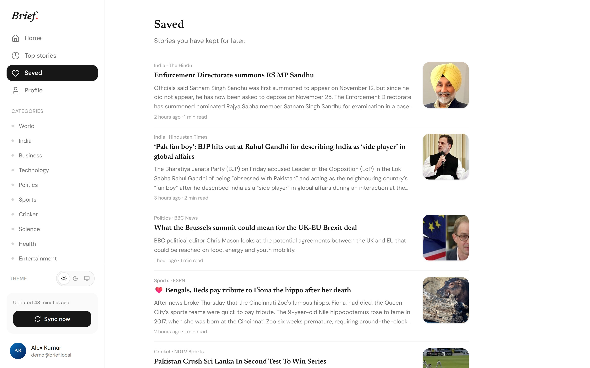</td>
  </tr>
  <tr>
    <td align="center"><b>Top stories</b>: the 25 most-covered stories of the last 24 hours</td>
    <td align="center"><b>Saved</b>: bookmarks are kept even after old articles are pruned</td>
  </tr>
</table>

### Sign in and sign up

<table>
  <tr>
    <td width="50%">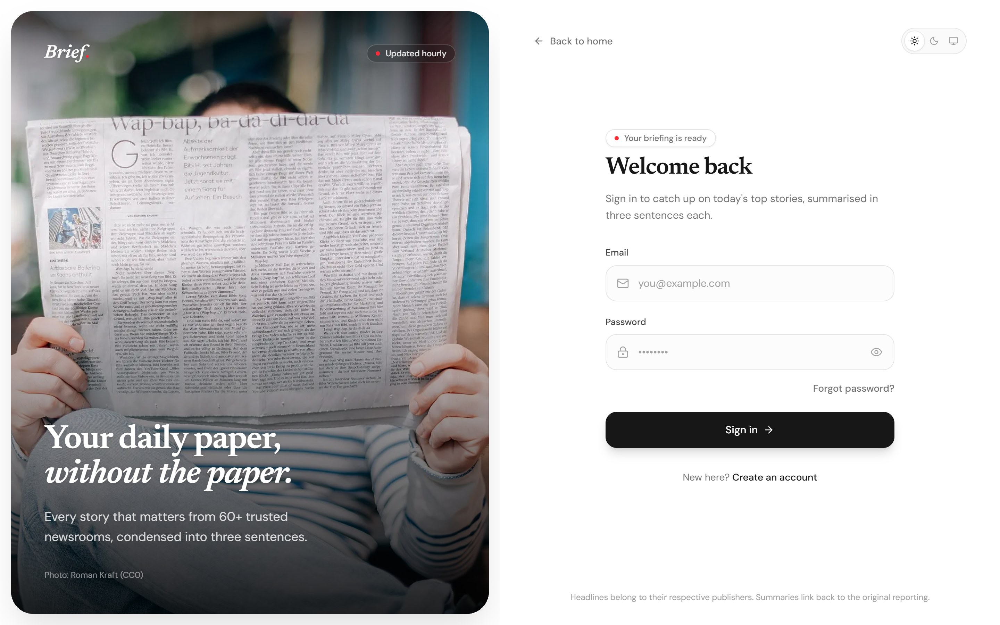</td>
    <td width="50%">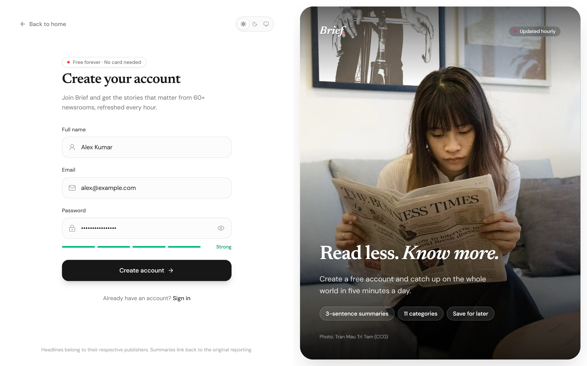</td>
  </tr>
  <tr>
    <td align="center"><b>Sign in</b></td>
    <td align="center"><b>Create account</b>, with a live password strength meter</td>
  </tr>
</table>

### Dark mode

A soft, cool-grey dark theme designed for long reading sessions: no pure black, no pure white, and slightly dimmed photos. Switch between Light, Dark and System from the toggle in the header, the sidebar or your profile. The choice is applied before first paint, so pages never flash.

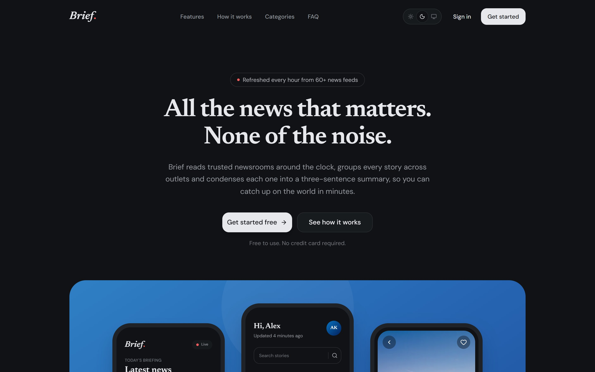

<table>
  <tr>
    <td width="50%">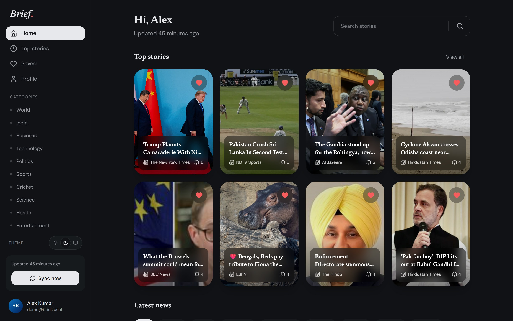</td>
    <td width="50%">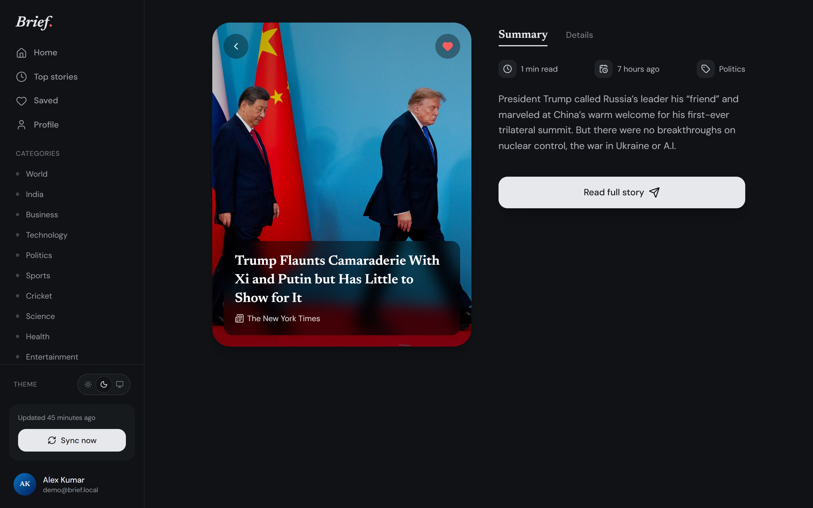</td>
  </tr>
  <tr>
    <td width="50%">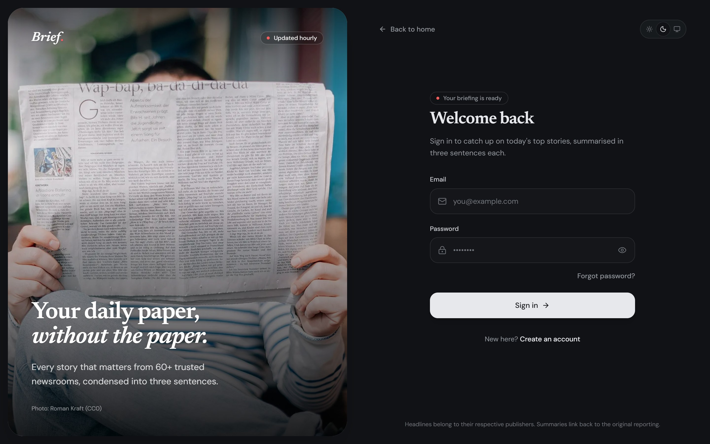</td>
    <td width="50%">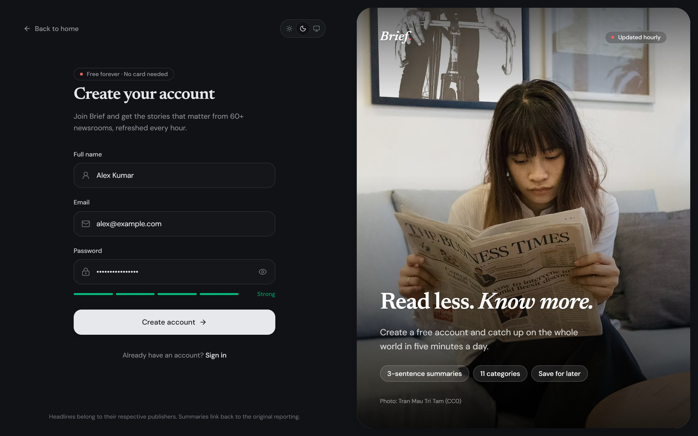</td>
  </tr>
</table>

### Mobile

<table>
  <tr>
    <td align="center" width="25%">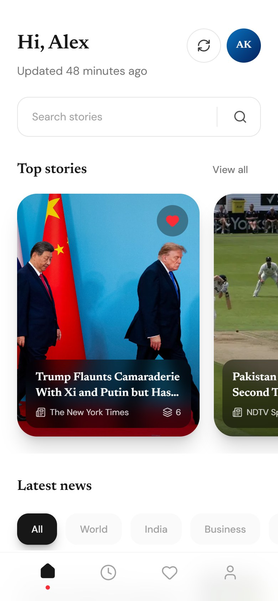<br /><sub>Feed</sub></td>
    <td align="center" width="25%">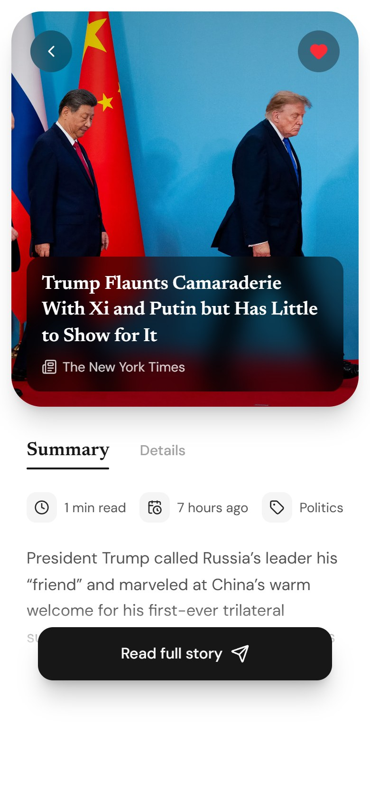<br /><sub>Summary</sub></td>
    <td align="center" width="25%">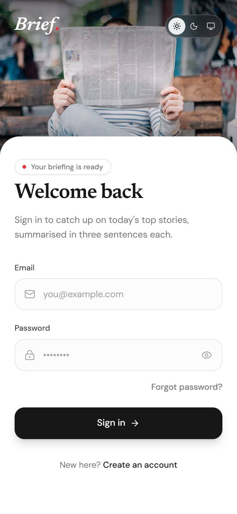<br /><sub>Sign in</sub></td>
    <td align="center" width="25%">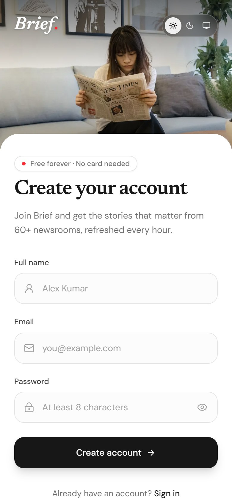<br /><sub>Sign up</sub></td>
  </tr>
</table>

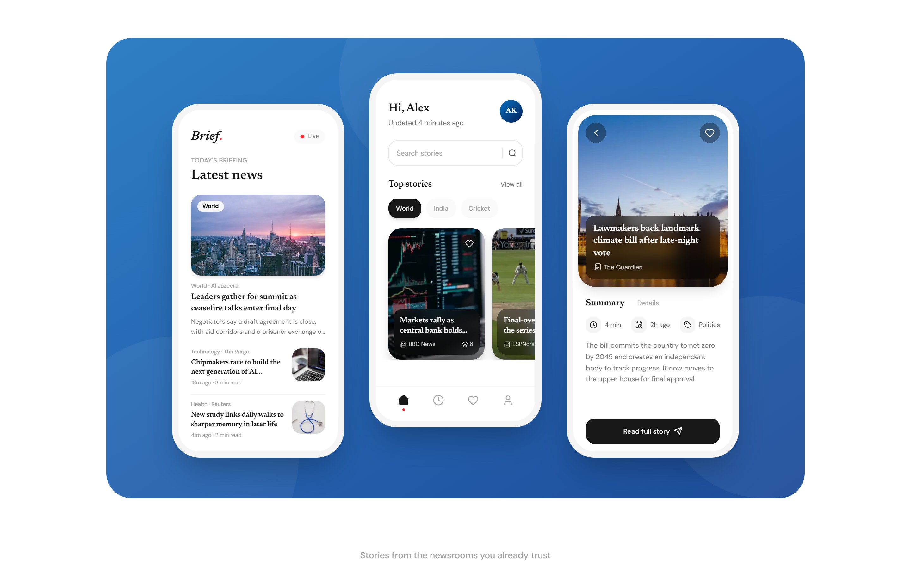

## Features

- **68 feeds, 11 categories**: World, India, Business, Technology, Politics, Sports, Cricket, Science, Health, Entertainment and Bangla
- **Three-sentence summaries** from TextRank, with no LLM and no API costs
- **Top stories** ranked by how many independent outlets cover them, with recency decay
- **Hourly sync** on a cron schedule, plus a manual "Sync now" button
- **Search and category filters** with infinite scroll
- **Bookmarks** that survive the 30-day retention window
- **Email and password auth** via Better Auth, including a password reset flow
- **Bengali support**, with danda sentence splitting, Bengali stopwords and Noto Bengali fonts
- **Light, dark and system themes** with a no-flash theme switch
- **Responsive**: a sidebar on desktop and a bottom navigation bar on mobile

## Stack

| Layer    | Tech                                                         |
| -------- | ------------------------------------------------------------ |
| Monorepo | Turborepo + pnpm workspaces                                  |
| Web      | Next.js 16 (App Router), Tailwind CSS v4, shadcn/ui          |
| API      | Express 5, Better Auth (email + password), Drizzle ORM       |
| Database | PostgreSQL 17 (Docker, Alpine) locally, any Postgres in prod |
| Jobs     | Croner, hourly sync                                          |

## Layout

```
apps/
  api/                  Express API, ingestion pipeline, scheduler
    drizzle/            SQL migrations
    auth/               Better Auth config and email templates
    ingestion/          feeds, extraction, TextRank summariser, story ranking
    modules/            news, bookmarks, sync (router + service per module)
  web/                  Next.js client
docs/screenshots/       README screenshots
packages/
  contracts/            Categories and DTO types shared by api and web
  env/                  Validated server environment
```

## Getting started

```bash
pnpm install
cp apps/api/.env.example apps/api/.env
cp apps/web/.env.example apps/web/.env.local
openssl rand -base64 32
pnpm db:up
pnpm db:migrate
pnpm dev
```

Paste the generated secret into `BETTER_AUTH_SECRET` in `apps/api/.env` before starting.

- Web: http://localhost:3000 (landing page; the app lives at `/feed` after sign-in)
- API: http://localhost:4000

On boot the API runs a sync if the last successful one is older than an hour. After that it syncs on `SYNC_CRON` (default: every hour on the hour). The sync button on the home screen triggers one manually.

## How it works

1. **Collect**: every feed in `apps/api/ingestion/sources.ts` is fetched in parallel. Entries are canonicalised (tracking params stripped), de-duplicated, limited to the last 48 hours, and skipped if already stored.
2. **Extract**: each new article page is parsed with Mozilla Readability. Paywalled or blocked pages fall back to the feed snippet.
3. **Summarise**: TextRank over sentence similarity with a lead-sentence bias picks the three most representative sentences, kept in their original order.
4. **Rank**: the last 24 hours of articles are clustered by TF-IDF cosine similarity. Clusters are scored by distinct-source coverage with a recency decay, and the top 25 are stored in `top_stories`.
5. **Retain**: articles older than 30 days are pruned unless someone has bookmarked them.

The web app calls the API through a Next.js rewrite (`/api/*`), so auth cookies stay first-party.

## Configuration

`apps/api/.env`

| Variable             | Description                                             |
| -------------------- | ------------------------------------------------------- |
| `DATABASE_URL`       | Postgres connection string (a Neon URL works as-is)     |
| `BETTER_AUTH_SECRET` | At least 32 characters                                  |
| `BETTER_AUTH_URL`    | Public URL of the web app (auth is served through it)   |
| `WEB_ORIGIN`         | Allowed origin for CORS and Better Auth trusted origins |
| `SYNC_CRON`          | Cron pattern for scheduled syncs                        |
| `PORT`, `LOG_LEVEL`  | Optional                                                |

`apps/web/.env.local`

| Variable  | Description                |
| --------- | -------------------------- |
| `API_URL` | Where the API is reachable |

Bangla stories come from BBC Bangla, Sangbad Pratidin and ABP Ananda, with full extraction and summaries (Bengali sentence splitting on the danda and Bengali stopwords are built in). Anandabazar Patrika blocks automated clients outright (HTTP 403 for every URL, including robots.txt), so its headlines come from the public Google News feed for anandabazar.com and are stored without a summary; they link straight to the original story. Sources marked `aggregated` in `sources.ts` follow this headline-only path.

To add or change feeds, edit `apps/api/ingestion/sources.ts`. To add a category, add it to `packages/contracts/categories.ts`, run `pnpm db:generate` and `pnpm db:migrate`, and give it feeds in `sources.ts`.

## Password reset emails

The reset flow (`/forgot-password` → email → `/reset-password`) is fully wired. Until a transport is configured, `apps/api/lib/mailer.ts` logs the email, including the reset link, to the API console. To send real email, implement the `Mailer` interface (for example with Resend) and export it as `mailer`.

## Scripts

| Command              | Description                                                                        |
| -------------------- | ---------------------------------------------------------------------------------- |
| `pnpm dev`           | Run web and API in watch mode                                                      |
| `pnpm build`         | Production build of every app                                                      |
| `pnpm test`          | Unit tests                                                                         |
| `pnpm check-types`   | Type-check every workspace                                                         |
| `pnpm db:up`         | Start local Postgres                                                               |
| `pnpm db:generate`   | Generate a migration from schema edits                                             |
| `pnpm db:migrate`    | Apply migrations                                                                   |
| `pnpm db:studio`     | Open Drizzle Studio                                                                |
| `pnpm clean:modules` | Delete every `node_modules` folder in the monorepo (run `pnpm install` afterwards) |

## Credits

All bundled photos are CC0 (public domain). The sign-in photo is by Roman Kraft, the sign-up photo is by Tran Mau Tri Tam, and the category images come from StockSnap and rawpixel. Sources are listed in `apps/web/public/images/auth/credits.json` and `apps/web/public/images/categories/credits.json`.
